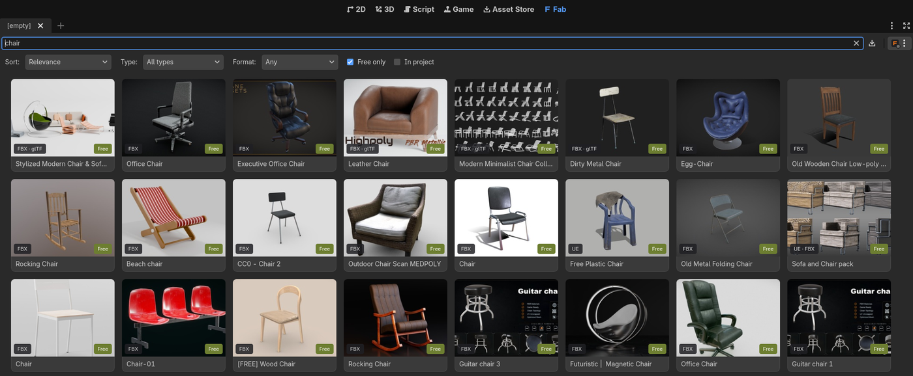

# GodotFab

*[English](README.md) | Português*

**Primeira vez? Comece pelo guia de [Primeiros passos](docs/GETTING_STARTED-PTBR.md).**

Addon para Godot 4.8 que traz a loja **Fab** (fab.com) para dentro do editor, no estilo do
addon BlenderKit: uma aba **Fab** na tela principal com busca, filtros, grade de thumbnails,
diálogo de detalhes e botão **Download**. Os assets são baixados da sua biblioteca Fab e
entram no projeto em `res://fab_assets/<nome>/`.



Três caminhos de importação, escolhidos pelo formato que a listagem oferece:

| Formato na Fab | O que o addon faz |
| --- | --- |
| glTF (.glb) | Baixa e copia o modelo e as texturas; o Godot importa direto. |
| FBX | Idem (o Godot importa FBX nativamente desde o 4.3). |
| Unreal Engine (.uasset), **só Linux** | Baixa o pacote, instala no projeto Unreal configurado, roda o **UnrealToGodot** em modo headless (commandlet) e importa o projeto Godot gerado. |

glTF e FBX funcionam em qualquer sistema (Linux, Windows e macOS). **O caminho Unreal só funciona
no Linux por enquanto**: o instalador do commandlet e a verificação do plugin são só para Linux.

O formato preferido fica em *Settings → Preferred format* (padrão: glTF, depois FBX, depois Unreal).

## Requisitos

- Godot 4.8 (testado com 4.8 beta2 mono).
- Conta Epic Games. O login usa o mesmo fluxo do Legendary/Heroic: o navegador abre a página da
  Epic, você copia o `authorizationCode` mostrado e cola no diálogo do addon.
- Assets grátis em glTF/FBX baixam direto. Assets pagos precisam estar na sua biblioteca Fab
  (compre no fab.com e depois clique em *Refresh library* no Godot; um download que estava
  esperando continua sozinho). Pacotes Unreal também precisam estar na biblioteca: para um
  grátis, o addon abre a página dele no fab.com (os endpoints de "adicionar à biblioteca" só
  aceitam a sessão do site, não o token do launcher): clique em *Add to My Library* lá e depois
  em *Refresh library*.
- Para o caminho Unreal (só Linux): Unreal Engine 5.8 para Linux instalado e um projeto Unreal com o plugin
  **UnrealToGodot** (Ciprian Stanciu) compilado com o commandlet da pasta `addons/godotfab/unreal/`.
  Sem isso, os formatos glTF/FBX continuam funcionando.

## Instalação

1. Copie `addons/godotfab` para o seu projeto e ative o plugin em *Project → Project Settings →
   Plugins*. (Este repositório já é um projeto Godot com o addon ativado.)
2. Abra a aba **Fab** na barra superior do editor.
3. Menu (ícone no canto direito da busca) → **Log In to Epic Games…**.
4. Menu → **Settings…**: pasta de download, formato preferido e, para Unreal, o `.uproject`,
   a pasta do engine e a versão (`UE_5.8`). O botão **Check Unreal setup** confere cada item.

### Commandlet do UnrealToGodot (só para o caminho Unreal)

O UnrealToGodot exporta pelo botão da toolbar do editor Unreal. Para automatizar, o addon
adiciona um commandlet ao plugin. Informe a pasta do engine e o projeto Unreal:

```sh
addons/godotfab/unreal/install_commandlet.sh "<engine_dir>" "<project_dir>/<Project>.uproject"
```

O script copia `addons/godotfab/unreal/UnrealToGodotCommandlet/*` para `Plugins/UnrealToGodot/Source/UnrealToGodot/Public/`,
faz backup de `Binaries/` e recompila o plugin com o UnrealBuildTool (cerca de 20 min na primeira
vez). Ele também aplica um ajuste de uma linha em `GodotScene.cpp` do plugin (guarda
`!FApp::IsUnattended()` antes de abrir a janela de opções do glTF, que não existe em modo
commandlet); o original fica em `GodotScene.cpp.godotfab-orig`. O addon invoca
`UnrealEditor-Cmd <projeto> -run=UnrealToGodot.UnrealToGodot -ContentPath=/Game/<Pasta>[,/Game/<Outra>…]
[-Map=…] -Output=<pasta> -unattended -AllowCommandletRendering`. Detalhes em `addons/godotfab/unreal/README.md`.

Pacotes que instalam várias pastas na raiz de `Content` (amostras Megascans, como *Medieval
Village*) passam todas em `-ContentPath`. No modo automático, o mapa escolhido é o mais pesado
do pacote (o `.umap` mais os seus `__ExternalActors__`), ou seja, o nível principal e não um
subnível vazio. Mapas World Partition têm todos os atores carregados antes da exportação.

Validado nesta máquina com o pacote *Laundromat VOL2* já instalado: exportação do mapa Overview
em 68 s (138 meshes, 163 nós) e do modo "todos os meshes" em 84 s (151 meshes), seguida da
importação para um projeto Godot com todos os caminhos `res://` reescritos.

Se o commandlet não estiver disponível, o diálogo de detalhes oferece o modo manual: **Open in
Unreal Editor** abre o mapa do pacote; rode *UnrealToGodot → Export To Godot* e depois use
**Import export folder…** apontando para a pasta exportada.

## Como funciona

1. Busca pública em `fab.com/i/listings/search` (sem login), filtrada pelos formatos
   glTF/FBX/Unreal; thumbnails em cache em `<editor data>/godotfab/thumbs`.
2. Ao baixar, o addon procura a listagem na sua biblioteca (`/e/accounts/<id>/ue/library`),
   pede o manifesto assinado (`POST /e/artifacts/<artifactId>/manifest` ou, para glTF/FBX,
   `/p/egl/listings/<uid>/asset-formats/<fmt>/files/<file>/download-info`), baixa os chunks do
   CDN da Epic em paralelo, remonta os arquivos e confere o SHA-1 de cada um. Downloads
   interrompidos continuam de onde pararam (`res://.godotfab/downloads/<uid>`, no disco do
   projeto: instalar o pacote num projeto Unreal do mesmo disco e importar o export viram
   `rename`, sem cópia; a pasta fica fora do FileSystem dock e do git).
3. glTF/FBX: zips são extraídos e os modelos/texturas copiados para `res://fab_assets/<nome>/`.
   Unreal: o conteúdo vai para `Content/` do projeto Unreal (arquivos existentes são salvos em
   `Saved/GodotFabBackups/`), o commandlet exporta o mapa *Overview* (ou um level gerado com
   todos os meshes) e a pasta exportada é copiada para o projeto com os caminhos `res://`
   reescritos. Cada pasta importada guarda um `.godotfab.json` com a origem. Reimportar
   **sincroniza** a pasta em vez de substituí-la: arquivos com o mesmo tamanho e MD5 não são
   tocados (e o `.import` que a Godot reescreveu é mantido se o asset não mudou), então a
   Godot só reimporta o que mudou de fato. Arquivos que saíram do export são apagados.
4. Os arquivos baixados ficam guardados: ao terminar, o addon mantém os chunks em
   `res://.godotfab/downloads/<uid>/dl*/chunks`. Ele apaga só o que já é cópia: os
   arquivos remontados (já estão no projeto Unreal ou no Godot) e a pasta exportada (já foi
   importada). Assim, **Download again** remonta tudo do cache, sem rede. Para desligar, use
   *Editor Settings → GodotFab → Downloads → Keep Downloaded Files*. O botão **Delete
   downloaded files (tamanho)** no detalhe do asset apaga esse cache. O asset continua no
   projeto Godot e no projeto Unreal.
5. **Convert again** (pacotes Unreal já importados) roda de novo só o commandlet sobre o
   pacote que já está instalado no `Content/` do projeto Unreal e reimporta o resultado.
   Ele não baixa nada nem reinstala, então é o caminho para conferir uma correção no
   exportador. **Retry**, depois de uma falha na conversão, faz o mesmo.

Os endpoints da Fab não são documentados pela Epic (são os que o Epic Games Launcher e o
plugin Fab do Unreal usam); podem mudar sem aviso. Estão isolados em `addons/godotfab/fab_api.gd`.

## Problemas comuns

- **HTTP 403 ao pedir o manifesto**: a Fab limita a taxa de downloads; espere um minuto.
- **"Accept Fab's terms"**: abra a listagem no site, aceite os termos uma vez e tente de novo.
- **Conversão Unreal falhou**: o diálogo mostra as últimas linhas do log (`convert.log` na pasta
  de download). Verifique *Check Unreal setup* e tente o modo manual.
- **Busca com erro 429**: muitas buscas seguidas; o addon espera e repete uma vez.
- **"Redefinition of 'X'" nos shaders convertidos**: o Godot 4.8 declara um uniform por nó de
  parâmetro e deixou de mesclar nomes repetidos (o 4.7 ainda mescla). O UnrealToGodot gera um
  nó por expressão do Unreal, então o mesmo parâmetro aparece repetido no mesmo grafo e também
  nos grafos de vertex e fragment. O importador corrige isso automaticamente
  (`addons/godotfab/export_fixes.gd`): nós repetidos do mesmo tipo no mesmo grafo viram um só
  (as conexões passam para o nó mantido) e o parâmetro de textura do lado vertex é renomeado
  para `<Nome>_VS`. Para uma pasta importada antes
  dessa correção, rode o fixer nela: a função `ExportFixes.fix_export_tree(<pasta absoluta>)`.
- **"Expected a ';'" ou "Unknown character #35: '#'" nos shaders convertidos**: dois outros
  casos que o importador corrige. O UnrealToGodot copia o nome do parâmetro do Unreal como
  está (`Level 1 Wind`, `Use gradient`), e um nome com espaço não é um identificador válido.
  O importador troca os caracteres inválidos por `_`, no shader e nos materiais. Nas
  expressões customizadas, ele troca `COMPILER_HLSL` por um float (`#if 0.0`). O
  pré-processador da Godot só aceita inteiro e rejeita o shader inteiro (o erro aponta para o
  primeiro `#define`), então a condição vira `#if 0`. No Medieval Village isso afetava as
  árvores (spruce), as plantas (barley, kidney weed, dead herb weed) e as caixas de texto.
- **"Error while loading file" ao abrir a cena no editor**: o UnrealToGodot grava o nó
  `CollisionShape3D` do prefab mesmo quando pula a forma (mesh sem convex hull nem LOD de
  colisão), deixando `shape = SubResource("…")` sem o `[sub_resource]`. A Godot recusa o prefab
  ("Invalid parameter") e o editor recusa toda cena que o instancia. O importador remove esses
  nós (`fix_missing_shape_subresources`). No Medieval Village eram 6 prefabs (paredes,
  fachada, janela).
- **Colisão deslocada do mesh**: bug do UnrealToGodot (também na exportação pela UI): a
  `CollisionShape3D` do prefab recebe o transform de mundo da instância que gerou o prefab, e na
  cena ela fica deslocada em dobro. O `install_commandlet.sh` aplica um segundo patch de uma
  linha em `GodotScene.cpp` (a colisão do próprio mesh fica com transform identidade) e o
  importador corrige exports antigos (`fix_prefab_collision_text`).
- **"Parent path ... has vanished" ao abrir a cena**: outro bug do UnrealToGodot: nós com dois
  ou mais níveis (luminárias, splines do túnel…) recebem o caminho do pai invertido
  (`StaticMesh/Ator` em vez de `Ator/StaticMesh`) e o Godot descarta esses nós. O
  `install_commandlet.sh` aplica um terceiro patch em `GodotScene.cpp` e o importador corrige
  exports antigos (`fix_scene_parent_paths`).
- **Cena estourada / branca demais**: o UnrealToGodot exporta as lâmpadas com 1000× os lumens do
  Unreal e `light_energy = 16`, e o SDFGI ainda rebate essa luz. O importador reduz o
  `light_energy` dessas luzes para `0.16`; com isso o UndergroundTunnel fica próximo das
  imagens de referência do pacote.
- **Ambiente (WorldEnvironment) diferente do Unreal**: o UnrealToGodot grava um modelo fixo
  (céu claro como luz ambiente, sem neblina). O commandlet do GodotFab regrava o
  `WorldEnvironment.tscn` a partir do nível: SkyLight (ou nenhuma luz de céu, se o nível
  não tem), ExponentialHeightFog e neblina volumétrica, raio de AO e tonemapper ACES.
  Exports feitos pela UI do Unreal continuam com o modelo fixo.
- **"UID duplicate detected" / "invalid UID" com dois pacotes no projeto**: o UnrealToGodot grava
  os mesmos UIDs em todo export (`WorldEnvironment.tscn`, `CameraAttributes.tres`,
  `notify_player.gd`…) e referencia `notify_player.gd` com um UID diferente do seu `.gd.uid`. O
  importador troca todos os UIDs do pacote por UIDs próprios (derivados da pasta, estáveis entre
  reimportações; mapa em `.godotfab_uids`) e corrige as referências desencontradas.
- **Material branco com o texto "Shader didn't compile"**: o material falhou ao compilar no
  próprio Unreal (no UndergroundTunnel, `M_Env_PDO_POM` não compila no UE 5.8:
  `ParallaxOcclusionMapping ... Not enough components`), e o UnrealToGodot põe esse
  placeholder no lugar. O importador avisa no Output quais materiais vieram assim; troque-os
  por um material Godot com as texturas do MI (veja o erro no log do Unreal).

## Testes

```sh
GODOT=/path/to/Godot_v4.8_mono_linux.x86_64
"$GODOT" --headless --path . -s tests/run_tests.gd            # unitários (sem rede)
"$GODOT" --headless --path . -s tests/run_tests.gd -- jobs    # só um arquivo
GODOTFAB_SMOKE=1 "$GODOT" --headless --editor --path .        # smoke da UI contra a Fab real
```

As fixtures de manifesto são geradas por `python3 -I tests/fixtures/make_manifest_fixtures.py`.

## Releases

As releases são geradas pelo GitHub Actions (`.github/workflows/release.yml`). Para publicar uma:

1. Coloque a nova versão em `version=` no `addons/godotfab/plugin.cfg` e faça o commit.
2. Crie uma tag nesse commit com a mesma versão e envie a tag:
   ```sh
   git tag v0.2.0 && git push origin v0.2.0
   ```

O workflow confere se a tag bate com o `plugin.cfg`, compacta `addons/godotfab/` num zip (extraia
na raiz de um projeto Godot) e cria a release. As notas listam os PRs mesclados desde a tag
anterior, agrupados por label (`.github/release.yml`), e em seguida todos os commits do período.

## Licença

[MIT](LICENSE).

## Créditos

- Estrutura da UI inspirada no addon [BlenderKit para Godot](https://github.com/BlenderKit/bk_godot).
- Endpoints e formato do manifesto/chunks conforme [fab-downloader](https://github.com/Fobal/fab-downloader),
  [epic-fab](https://github.com/StarksLabs/epic-fab), [egs-api-rs](https://github.com/AchetaGames/egs-api-rs)
  e [legendary](https://github.com/legendary-gl/legendary).
- Conversão Unreal → Godot pelo plugin [UnrealToGodot](https://www.youtube.com/watch?v=thGvNU1WH58) de Ciprian Stanciu.
