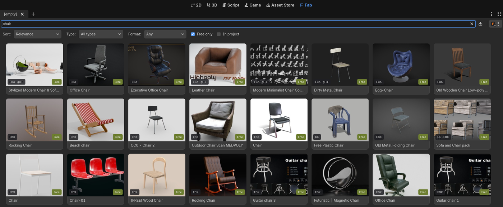

# GodotFab

*English | [Português](README-PTBR.md)*

**New here? Start with the [Getting started guide](docs/GETTING_STARTED.md).**

A Godot 4.8 addon that brings the **Fab** store (fab.com) into the editor, in the style of the
BlenderKit addon: a **Fab** tab on the main screen with search, filters, a thumbnail grid, a
details dialog and a **Download** button. Assets are downloaded from your Fab library and land
in the project under `res://fab_assets/<name>/`.



There are three import paths, chosen by the format the listing offers:

| Format on Fab | What the addon does |
| --- | --- |
| glTF (.glb) | Downloads and copies the model and textures; Godot imports them directly. |
| FBX | Same (Godot has imported FBX natively since 4.3). |
| Unreal Engine (.uasset), **Linux only** | Downloads the package, installs it into the configured Unreal project, runs **UnrealToGodot** headless (commandlet) and imports the generated Godot project. |

glTF and FBX work on every platform (Linux, Windows and macOS). **The Unreal path only works on
Linux for now**: the commandlet installer and the plugin check are Linux only.

The preferred format is set in *Settings → Preferred format* (default: glTF, then FBX, then Unreal).

## Requirements

- Godot 4.8 (tested with 4.8 beta2 mono).
- An Epic Games account. Login uses the same flow as Legendary/Heroic: the browser opens the
  Epic page, you copy the `authorizationCode` it shows and paste it into the addon's dialog.
- Free glTF/FBX assets download directly. Paid assets must be in your Fab library (buy them on
  fab.com, then *Refresh library* in Godot; a download that was waiting resumes on its own).
  Unreal packages must be in your library too: for a free one, the addon opens its page on
  fab.com (the "add to library" endpoints only accept the website session, not the launcher
  token): click *Add to My Library* there and then *Refresh library*.
- For the Unreal path (Linux only): Unreal Engine 5.8 for Linux installed and an Unreal project with the
  **UnrealToGodot** plugin (Ciprian Stanciu) built with the commandlet from the `addons/godotfab/unreal/` folder.
  Without it, the glTF/FBX formats keep working.

## Installation

1. Copy `addons/godotfab` into your project and enable the plugin in *Project → Project Settings →
   Plugins*. (This repository is already a Godot project with the addon enabled.)
2. Open the **Fab** tab in the editor's top bar.
3. Menu (icon to the right of the search box) → **Log In to Epic Games…**.
4. Menu → **Settings…**: download folder, preferred format and, for Unreal, the `.uproject`,
   the engine folder and the version (`UE_5.8`). The **Check Unreal setup** button verifies each item.

### UnrealToGodot commandlet (Unreal path only)

UnrealToGodot exports through a button in the Unreal editor toolbar. To automate it, the addon
adds a commandlet to the plugin. Pass the engine folder and the Unreal project:

```sh
addons/godotfab/unreal/install_commandlet.sh "<engine_dir>" "<project_dir>/<Project>.uproject"
```

The script copies `addons/godotfab/unreal/UnrealToGodotCommandlet/*` into `Plugins/UnrealToGodot/Source/UnrealToGodot/Public/`,
backs up `Binaries/` and rebuilds the plugin with UnrealBuildTool (about 20 min the first
time). It also applies a one-line change to the plugin's `GodotScene.cpp` (a
`!FApp::IsUnattended()` guard before opening the glTF options window, which does not exist in
commandlet mode); the original is kept as `GodotScene.cpp.godotfab-orig`. The addon invokes
`UnrealEditor-Cmd <project> -run=UnrealToGodot.UnrealToGodot -ContentPath=/Game/<Folder>[,/Game/<Other>…]
[-Map=…] -Output=<folder> -unattended -AllowCommandletRendering`. Details in `addons/godotfab/unreal/README.md`.

Packages that install several folders at the root of `Content` (Megascans samples such as
*Medieval Village*) pass all of them in `-ContentPath`. In automatic mode, the chosen map is the
heaviest one in the package (the `.umap` plus its `__ExternalActors__`), i.e. the main level
and not an empty sublevel. World Partition maps have all their actors loaded before export.

Validated on this machine with the *Laundromat VOL2* package already installed: export of the
Overview map in 68 s (138 meshes, 163 nodes) and of the "all meshes" mode in 84 s (151 meshes),
followed by import into a Godot project with every `res://` path rewritten.

If the commandlet is not available, the details dialog offers manual mode: **Open in
Unreal Editor** opens the package's map; run *UnrealToGodot → Export To Godot* and then use
**Import export folder…** pointing at the exported folder.

## How it works

1. Public search on `fab.com/i/listings/search` (no login), filtered by the glTF/FBX/Unreal
   formats; thumbnails are cached in `<editor data>/godotfab/thumbs`.
2. On download, the addon looks up the listing in your library (`/e/accounts/<id>/ue/library`),
   requests the signed manifest (`POST /e/artifacts/<artifactId>/manifest` or, for glTF/FBX,
   `/p/egl/listings/<uid>/asset-formats/<fmt>/files/<file>/download-info`), downloads the chunks
   from Epic's CDN in parallel, reassembles the files and checks each one's SHA-1. Interrupted
   downloads resume where they stopped (`res://.godotfab/downloads/<uid>`, on the project's
   disk: installing the package into an Unreal project on the same disk and importing the
   export become a `rename`, with no copy; the folder is hidden from the FileSystem dock and git).
3. glTF/FBX: zips are extracted and the models/textures copied to `res://fab_assets/<name>/`.
   Unreal: the content goes into the Unreal project's `Content/` (existing files are saved to
   `Saved/GodotFabBackups/`), the commandlet exports the *Overview* map (or a generated level
   with all meshes) and the exported folder is copied into the project with its `res://` paths
   rewritten. Each imported folder keeps a `.godotfab.json` with its origin. Reimporting
   **syncs** the folder instead of replacing it: files with the same size and MD5 are not
   touched (and the `.import` that Godot rewrote is kept if the asset did not change), so
   Godot only reimports what actually changed. Files that left the export are deleted.
4. Downloaded files are kept: when done, the addon keeps the chunks in
   `res://.godotfab/downloads/<uid>/dl*/chunks`. It only deletes what is already a copy: the
   reassembled files (already in the Unreal or Godot project) and the exported folder (already
   imported). So **Download again** reassembles everything from the cache, without network. To
   turn this off, use *Editor Settings → GodotFab → Downloads → Keep Downloaded Files*. The
   **Delete downloaded files (size)** button in the asset details deletes that cache. The asset
   stays in the Godot project and in the Unreal project.
5. **Convert again** (Unreal packages already imported) reruns only the commandlet on the
   package already installed in the Unreal project's `Content/` and reimports the result.
   It downloads and reinstalls nothing, so it is the way to check a fix in the exporter.
   **Retry**, after a conversion failure, does the same.

The Fab endpoints are not documented by Epic (they are the ones the Epic Games Launcher and the
Unreal Fab plugin use); they may change without notice. They are isolated in `addons/godotfab/fab_api.gd`.

## Troubleshooting

- **HTTP 403 when requesting the manifest**: Fab rate-limits downloads; wait a minute.
- **"Accept Fab's terms"**: open the listing on the website, accept the terms once and try again.
- **Unreal conversion failed**: the dialog shows the last lines of the log (`convert.log` in the
  download folder). Run *Check Unreal setup* and try manual mode.
- **Search fails with error 429**: too many searches in a row; the addon waits and retries once.
- **"Redefinition of 'X'" in converted shaders**: Godot 4.8 declares one uniform per parameter
  node and no longer merges repeated names (4.7 still does). UnrealToGodot generates one node
  per Unreal expression, so the same parameter appears repeatedly in the same graph and also in
  both the vertex and fragment graphs. The importer fixes this automatically
  (`addons/godotfab/export_fixes.gd`): repeated nodes of the same type in the same graph become
  one (connections move to the kept node) and the vertex-side texture parameter is renamed to
  `<Name>_VS`. For a folder imported before this fix, run the fixer on it:
  `ExportFixes.fix_export_tree(<absolute folder>)`.
- **"Expected a ';'" or "Unknown character #35: '#'" in converted shaders**: two other cases the
  importer fixes. UnrealToGodot copies the Unreal parameter name as is (`Level 1 Wind`,
  `Use gradient`), and a name with a space is not a valid identifier. The importer replaces
  invalid characters with `_`, in the shader and in the materials. In custom expressions,
  UnrealToGodot replaces `COMPILER_HLSL` with a float (`#if 0.0`). Godot's preprocessor only
  accepts integers and rejects the whole shader (the error points at the first `#define`), so
  the condition becomes `#if 0`. In Medieval Village this affected the trees (spruce), the
  plants (barley, kidney weed, dead herb weed) and the text boxes.
- **"Error while loading file" when opening the scene in the editor**: UnrealToGodot writes the
  prefab's `CollisionShape3D` node even when it skips the shape (mesh with no convex hull or
  collision LOD), leaving `shape = SubResource("…")` without the `[sub_resource]`. Godot rejects
  the prefab ("Invalid parameter") and the editor rejects every scene that instances it. The
  importer removes those nodes (`fix_missing_shape_subresources`). In Medieval Village there
  were 6 prefabs (walls, facade, window).
- **Collision offset from the mesh**: an UnrealToGodot bug (also in the UI export): the prefab's
  `CollisionShape3D` gets the world transform of the instance that generated the prefab, so in
  the scene it is offset twice. `install_commandlet.sh` applies a second one-line patch to
  `GodotScene.cpp` (the mesh's own collision gets an identity transform) and the importer fixes
  older exports (`fix_prefab_collision_text`).
- **"Parent path ... has vanished" when opening the scene**: another UnrealToGodot bug: nodes
  two or more levels deep (lamps, tunnel splines…) get their parent path reversed
  (`StaticMesh/Actor` instead of `Actor/StaticMesh`) and Godot drops them.
  `install_commandlet.sh` applies a third patch to `GodotScene.cpp` and the importer fixes older
  exports (`fix_scene_parent_paths`).
- **Blown-out / overly white scene**: UnrealToGodot exports lamps with 1000× Unreal's lumens and
  `light_energy = 16`, and SDFGI bounces that light further. The importer lowers those lights'
  `light_energy` to `0.16`; with that, UndergroundTunnel comes close to the package's reference
  images.
- **Environment (WorldEnvironment) different from Unreal**: UnrealToGodot writes a fixed template
  (clear sky as ambient light, no fog). The GodotFab commandlet rewrites
  `WorldEnvironment.tscn` from the level: SkyLight (or no sky light if the level has none),
  ExponentialHeightFog and volumetric fog, AO radius and the ACES tonemapper.
  Exports made through the Unreal UI keep the fixed template.
- **"UID duplicate detected" / "invalid UID" with two packages in the project**: UnrealToGodot
  writes the same UIDs in every export (`WorldEnvironment.tscn`, `CameraAttributes.tres`,
  `notify_player.gd`…) and references `notify_player.gd` with a UID different from its
  `.gd.uid`. The importer replaces every UID in the package with its own (derived from the
  folder, stable across reimports; mapping in `.godotfab_uids`) and fixes the mismatched references.
- **White material with the text "Shader didn't compile"**: the material failed to compile in
  Unreal itself (in UndergroundTunnel, `M_Env_PDO_POM` does not compile on UE 5.8:
  `ParallaxOcclusionMapping ... Not enough components`), and UnrealToGodot puts this
  placeholder in its place. The importer reports in the Output which materials came out this
  way; replace them with a Godot material using the MI's textures (see the error in the Unreal log).

## Tests

```sh
GODOT=/path/to/Godot_v4.8_mono_linux.x86_64
"$GODOT" --headless --path . -s tests/run_tests.gd            # unit tests (no network)
"$GODOT" --headless --path . -s tests/run_tests.gd -- jobs    # a single file
GODOTFAB_SMOKE=1 "$GODOT" --headless --editor --path .        # UI smoke test against the real Fab
```

The manifest fixtures are generated by `python3 -I tests/fixtures/make_manifest_fixtures.py`.

## Releases

Releases are built by GitHub Actions (`.github/workflows/release.yml`). To publish one:

1. Set the new `version=` in `addons/godotfab/plugin.cfg` and commit it.
2. Tag that commit with the same version and push the tag:
   ```sh
   git tag v0.2.0 && git push origin v0.2.0
   ```

The workflow checks that the tag matches `plugin.cfg`, zips `addons/godotfab/` (extract it at the
root of a Godot project) and creates the release. The notes list the pull requests merged since
the previous tag, grouped by label (`.github/release.yml`), followed by every commit in that range.

## License

[MIT](LICENSE).

## Credits

- UI structure inspired by the [BlenderKit addon for Godot](https://github.com/BlenderKit/bk_godot).
- Endpoints and manifest/chunk format based on [fab-downloader](https://github.com/Fobal/fab-downloader),
  [epic-fab](https://github.com/StarksLabs/epic-fab), [egs-api-rs](https://github.com/AchetaGames/egs-api-rs)
  and [legendary](https://github.com/legendary-gl/legendary).
- Unreal → Godot conversion by the [UnrealToGodot](https://www.youtube.com/watch?v=thGvNU1WH58) plugin by Ciprian Stanciu.
