# Primeiros passos

*[English](GETTING_STARTED.md) | Português* · [Voltar ao README](../README-PTBR.md)

Este guia leva você de um projeto Godot vazio até um asset da Fab no seu projeto, usando os
formatos glTF ou FBX, que funcionam em qualquer sistema (Linux, Windows e macOS).

> **Assets de Unreal Engine funcionam só no Linux por enquanto.** Converter pacotes `.uasset`
> exige o Unreal Engine 5.8 e um plugin compilado no Linux; veja [o README](../README-PTBR.md#commandlet-do-unrealtogodot-só-para-o-caminho-unreal)
> se quiser configurar. Tudo abaixo funciona sem o Unreal.

## 1. Instale o addon

1. Na [página do repositório](https://github.com/alextrevisan/GodotFab), clique em
   *Code → Download ZIP* e extraia em qualquer lugar.
2. Copie a pasta `addons/godotfab` dele para o seu projeto Godot 4.8. Deve ficar
   `res://addons/godotfab/plugin.cfg`.
3. Na Godot, abra *Project → Project Settings*, vá na aba **Addons** e ative o **GodotFab**.

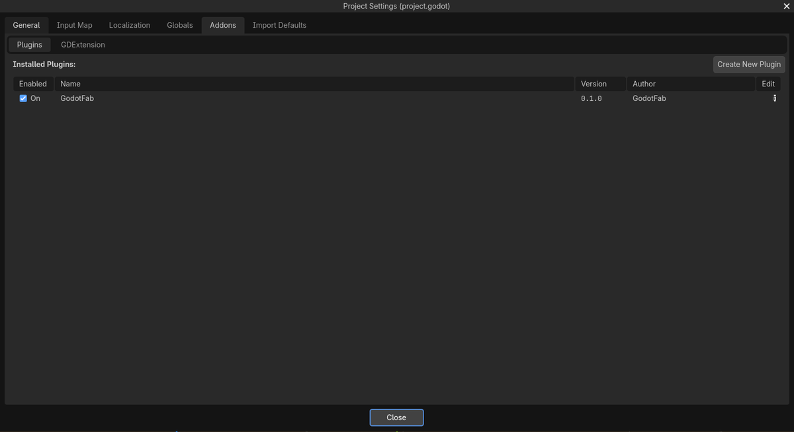

Aparece uma aba **Fab** na barra superior do editor, ao lado de 2D, 3D e Script.

## 2. Encontre um asset

1. Abra a aba **Fab**, digite na busca e aperte Enter.
2. Use os filtros para refinar: **Free only**, tipo, formato e ordenação. Cada card mostra os
   formatos que o asset oferece (glTF, FBX, UE) e o preço.
3. Clique num card para abrir os detalhes: descrição, formatos e preço.

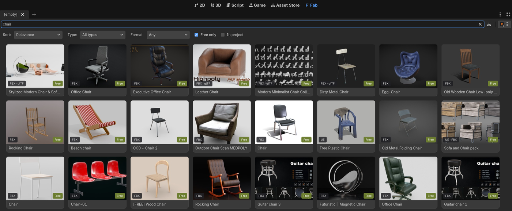

A busca funciona sem login.

## 3. Faça login na Epic Games

Os downloads vêm da sua biblioteca Fab, então você precisa de uma conta Epic Games.

1. Clique no menu ao lado da busca e escolha **Log In to Epic Games…**.

   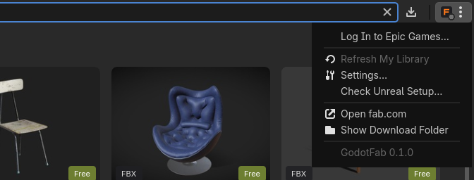

2. No diálogo, clique em **Open login page in browser**.

   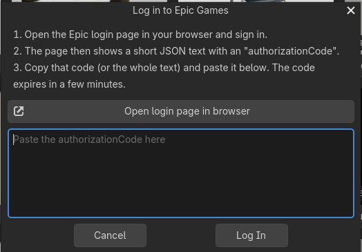

3. Faça login na página da Epic (ou escolha sua conta, se já estiver logado).

   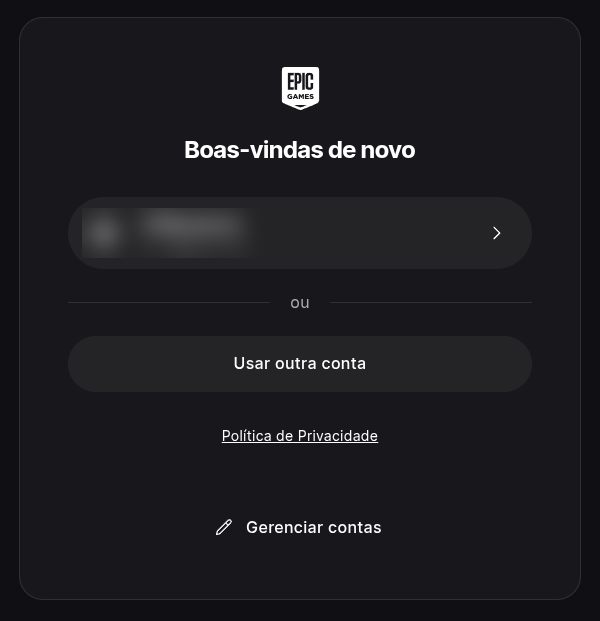

4. A página mostra um texto JSON curto. Copie o valor de `authorizationCode` (ou o texto
   inteiro), cole no diálogo e clique em **Log In**.

   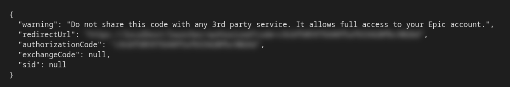

> Nunca compartilhe esse código: ele dá acesso à sua conta Epic. Ele expira em poucos minutos, e o
> login fica salvo, então isso só é feito uma vez.

## 4. Adicione o asset à sua biblioteca

A Fab só deixa baixar assets que estão na sua biblioteca. Quando um asset grátis ainda não está
lá, os detalhes mostram **Not in your library yet**:

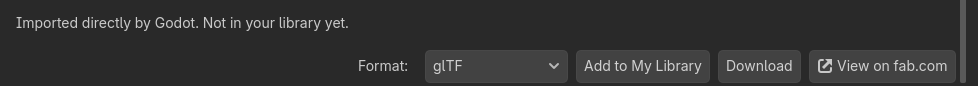

1. Clique em **Add to My Library**. A página do asset abre no navegador.
2. Clique em **Add to My Library** no fab.com.

   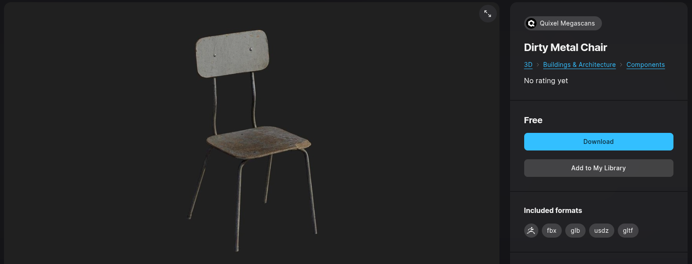

3. De volta à Godot, use **Refresh library** (nos detalhes ou no menu).

Assets pagos precisam ser comprados no fab.com antes (**Buy on fab.com**). Se você clicar em
**Download** antes de o asset estar na biblioteca, o download espera e continua sozinho quando ele
aparecer.

## 5. Baixe

1. Nos detalhes, escolha o **Format** e clique em **Download**. Por padrão o addon escolhe glTF e
   depois FBX (*Settings → Preferred format*).

   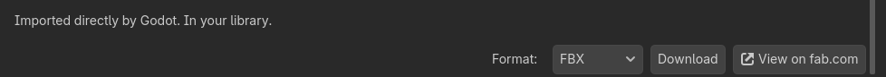

2. O progresso aparece nos detalhes e no card. Downloads interrompidos continuam de onde pararam.

   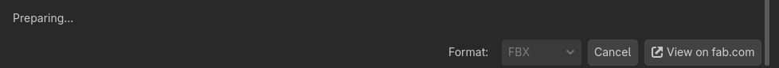

3. Ao terminar, os detalhes mostram onde o asset ficou no projeto.

   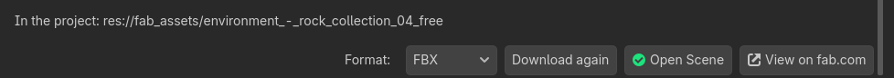

## 6. Use os arquivos

Os arquivos ficam em `res://fab_assets/<nome do asset>/`, no painel FileSystem:

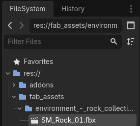

Arraste o `.glb` / `.fbx` para a viewport 3D para colocá-lo numa cena. Para editar o modelo
importado, clique com o botão direito nele na cena e escolha *Make Local*, ou use
*Scene → New Inherited Scene*.

## Próximos passos

- Configurações como a pasta de download ficam em menu → **Settings…**.
- Problemas de download (HTTP 403, termos da Fab, erro 429) estão em
  [Problemas comuns](../README-PTBR.md#problemas-comuns).
