# Getting started

*English | [Português](GETTING_STARTED-PTBR.md)* · [Back to the README](../README.md)

This guide takes you from an empty Godot project to a Fab asset in your project, using the
glTF or FBX formats, which work on every platform (Linux, Windows and macOS).

> **Unreal Engine assets are Linux only for now.** Converting `.uasset` packages needs Unreal
> Engine 5.8 and a plugin built on Linux; see [the README](../README.md#unrealtogodot-commandlet-unreal-path-only) if you want
> to set it up. Everything below works without Unreal.

## 1. Install the addon

1. On the [repository page](https://github.com/alextrevisan/GodotFab), click *Code → Download ZIP*
   and extract it anywhere.
2. Copy its `addons/godotfab` folder into your Godot 4.8 project. You should end up with
   `res://addons/godotfab/plugin.cfg`.
3. In Godot, open *Project → Project Settings*, go to the **Addons** tab and turn **GodotFab** on.

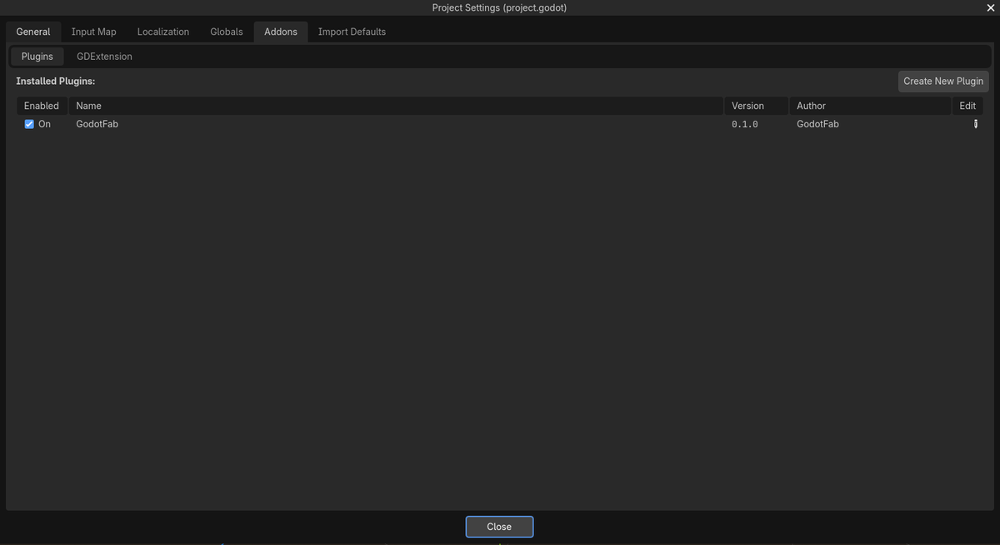

A **Fab** tab appears in the editor's top bar, next to 2D, 3D and Script.

## 2. Find an asset

1. Open the **Fab** tab, type in the search box and press Enter.
2. Use the filters to narrow the results: **Free only**, type, format and sort order. Each card
   shows the formats it offers (glTF, FBX, UE) and its price.
3. Click a card to open its details: description, formats and price.

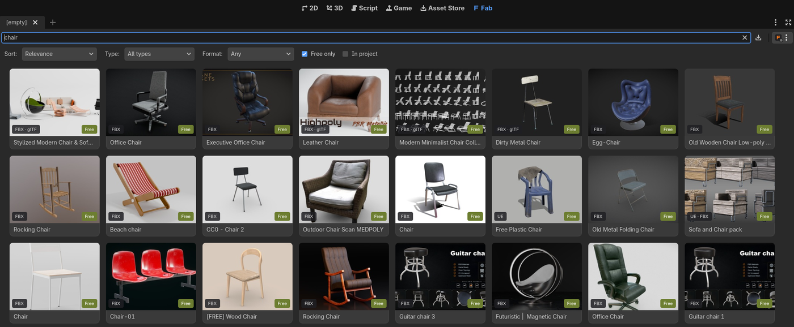

Searching works without logging in.

## 3. Log in to Epic Games

Downloads come from your Fab library, so you need an Epic Games account.

1. Click the menu next to the search box and choose **Log In to Epic Games…**.

   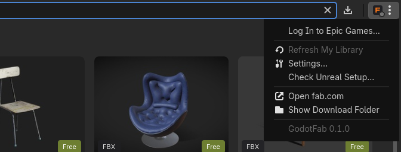

2. In the dialog, click **Open login page in browser**.

   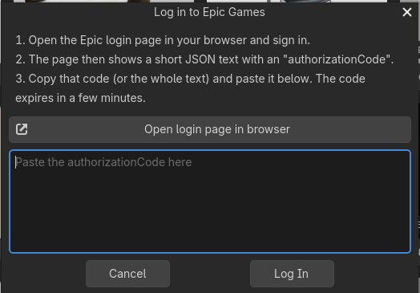

3. Log in on the Epic page (or pick your account if you are already logged in).

   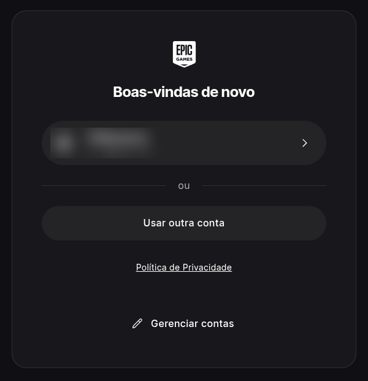

4. The page shows a short JSON text. Copy the value of `authorizationCode` (or the whole text),
   paste it into the dialog and click **Log In**.

   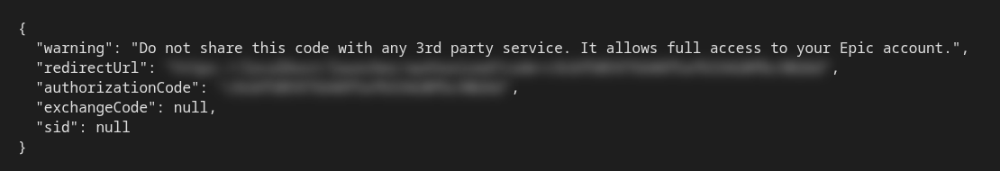

> Never share this code: it gives access to your Epic account. It expires in a few minutes, and
> the login is saved, so you only do this once.

## 4. Add the asset to your library

Fab only lets you download assets that are in your library. When a free asset isn't there yet,
the details say **Not in your library yet**:

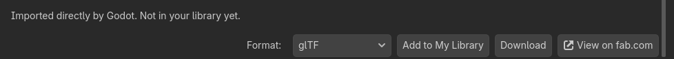

1. Click **Add to My Library**. The asset page opens in the browser.
2. Click **Add to My Library** on fab.com.

   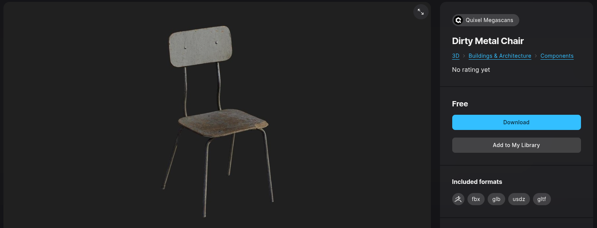

3. Back in Godot, use **Refresh library** (in the details or in the menu).

Paid assets must be bought on fab.com first (**Buy on fab.com**). If you click **Download** before
the asset is in your library, the download waits and continues on its own once it shows up.

## 5. Download

1. In the details, pick the **Format** and click **Download**. By default the addon picks glTF,
   then FBX (*Settings → Preferred format*).

   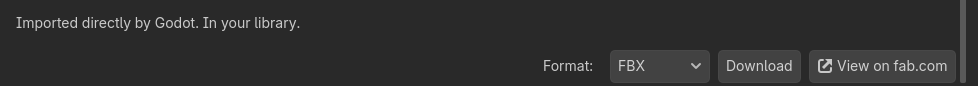

2. The progress shows in the details and on the card. Downloads that stop halfway continue
   where they stopped.

   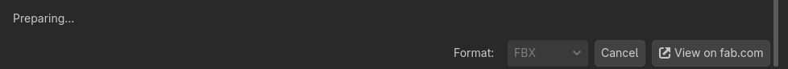

3. When it finishes, the details show where the asset is in the project.

   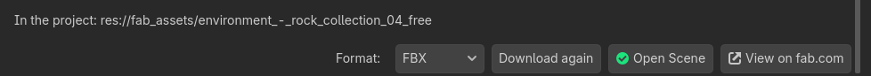

## 6. Use the files

The files are in `res://fab_assets/<asset name>/`, in the FileSystem dock:

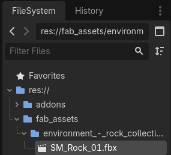

Drag the `.glb` / `.fbx` file into the 3D viewport to place it in a scene. To edit the imported
model, right-click it in the scene and choose *Make Local*, or use *Scene → New Inherited Scene*.

## Next steps

- Settings such as the download folder are in the menu → **Settings…**.
- Download problems (HTTP 403, Fab terms, error 429) are explained in
  [Troubleshooting](../README.md#troubleshooting).
